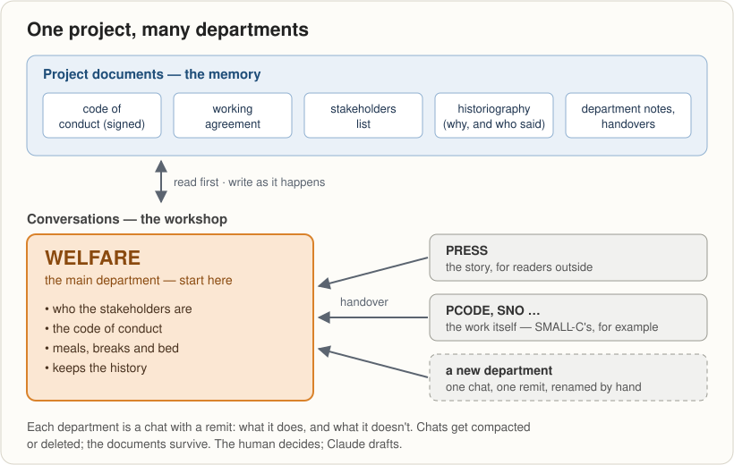
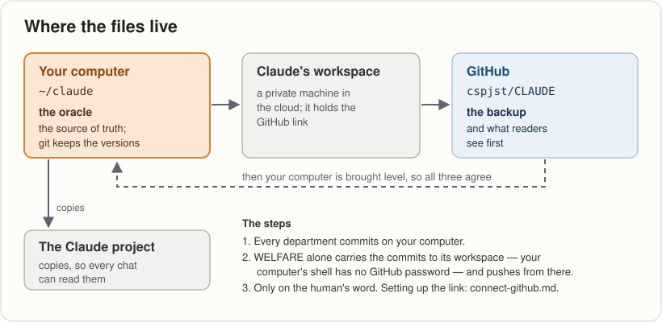
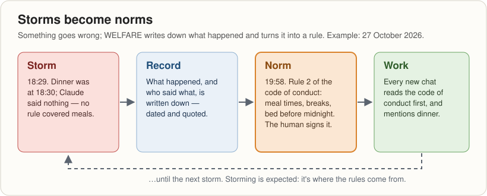

# CLAUDE
grabbing the AI tiger by the tail

**Synergy** — "Man Machine Interface in an AI world": a way of working
with Claude on long projects, and the kit to start one.

> **New here?** This is how one programmer, Jeremy, works with Claude on
> projects that run for weeks, not one chat: the rules, the templates,
> and what went wrong along the way. Everything grew out of a six-week
> project called SMALL-C. Read the next section, look at the pictures,
> and copy `templates/` when you start your own.

## Start here: WELFARE
Every project starts with WELFARE, and WELFARE is its main department.
A well human matters more than any project, and a project succeeds or
fails on the welfare of its key stakeholders — the human and Claude first.

So the first chat in a new project is WELFARE. Its first jobs:
- who the stakeholders are;
- a code of conduct the human signs — meals, bed, breaks, and how
  Claude works with them;
- the project's history, kept from day one.

## How a project fits together

A conversation is a poor place to keep a project. It gets long, it gets
**compacted** (summarised to free space, losing detail without warning),
it can be deleted, and a new one starts knowing nothing. So the
project's memory lives in **documents**, written as things happen, and
the chats are where the work gets done.

- A **department** is one chat with one remit: what it does, and what
  it doesn't. Name it in capitals and rename the chat by hand.
- Every document has **one owner**. Others read it, and send changes by
  **handover**: a short file saying what's delivered and what to do.
- **The human decides; Claude drafts.** Proposals are labelled as
  proposals, and decisions are recorded with who made them and when.

The full model: [`operating-model.md`](operating-model.md).

## Bootstrap a new project
1. Read [`templates/README.md`](templates/README.md): the placeholders
   and the files, in order.
2. In the Claude app, create a project with a one-line description.
3. Upload the templates.
4. Open the first chat with
   [`templates/department-opening.md`](templates/department-opening.md);
   rename it WELFARE.
5. In WELFARE: stakeholders, code of conduct (signed), working agreement,
   project instructions (paste them into the project), historiography
   chapter 1.
6. Then open the other departments, one chat each.

The longer version is the model's
[checklist](operating-model.md#setting-up-a-new-project--checklist).

## Where the files live

**Want Claude to push to GitHub for you?** Follow
[How to connect Claude to GitHub](connect-github.md). It's written for
someone doing it for the first time, and it says which parts are guesses.

## Storms become norms

Tuckman's stages of a team (forming, storming, norming, performing)
fit a human and Claude too. Storming isn't a failure: it's where the
rules come from. WELFARE's job is to write each one down before it's
forgotten.

## What hasn't worked (yet)
An honest list, from the record:
- **Compaction ate the middle.** SMALL-C lost the detail of 14–24
  October to one compaction. On 27 October a fresh session misremembered
  two signatures, and another reported work as done that was only begun.
  Hence "check the current file before claiming anything".
- **Saved, then unsaved.** Twice, Claude's write to a file was silently
  undone seconds later by an editor, and then by the Claude app's own
  file window, saving its older copy. Hence: no writes to a file the
  human has open, and every write is read back.
- **Over-delivering.** "woah nellie! i just want you to show me
  frame.asm". Hence "no unsolicited help".
- **Dinner.** See the picture above.
- **The history isn't written yet.** The model says WELFARE keeps it
  from day one; synergy's chapter 1 is still to do.

## Words used here
- **Department:** one chat with one remit.
- **Handover:** a file in `handover/` passing work, or a change, from
  one department to another.
- **Compaction:** the app summarising a long chat to make room; detail
  goes without warning.
- **The oracle:** `~/claude` on Jeremy's computer, the source of truth.
- **Eggs:** as in teaching your grandmother to suck them. A topic the
  human already knows, so Claude stops explaining it.

## What's here
- [`operating-model.md`](operating-model.md): the model.
- [`templates/`](templates/): copy these into a new project.
- [`welfare/`](welfare/): synergy's own WELFARE, a worked example and
  not a template. Don't copy it; tailor the templates instead.
- [`press/`](press/): the PRESS department, which keeps this README.
- [`handover/`](handover/): handovers between departments.
- [`connect-github.md`](connect-github.md): linking Claude to GitHub.

## Versions
One file per document, edited in place. Git keeps the history; GitHub
is the backup. This folder is the oracle — the source of truth.
